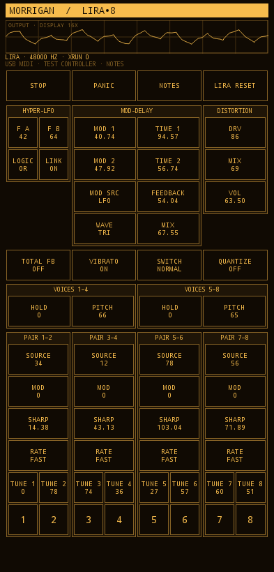

# MORRIGAN Mobile: complete LIRA panel

`mobile/app/src/main/java/org/morrigan/mobile/LiraPanelView.java` presents all **47 original LIRA parameters**, eight momentary voice pads and a small live output scope. It replaces the earlier scope-only interaction with a compact instrument module. The layout follows the upstream panel's functional grouping: Hyper-LFO, Mod-Delay, Distortion/master, global switches, voice-group hold/pitch, four paired source/modulation/sharpness/rate sections, and eight tuning controls.

The presentation is original Android UI in amber, using the built-in monospace typeface and geometric drawing. No Macintosh ROM, system software, copied Apple icon, proprietary font or copied upstream screenshot is included. This is a Mac-inspired musical instrument, not Mac OS emulation or a ZacOS port.

## Interaction

- Every parameter is visible as a named value button. Tapping a continuous parameter opens a native precision slider with 0.01 resolution and ±1 buttons. Changes are sent immediately. Fractional upstream preset values are preserved until deliberately adjusted.
- Tapping a choice cycles its actual upstream options. Holding it opens an explicit choice dialog. Labels come from `LiraControls`, including the original modulation routing choices.
- Swipe to scroll on short/landscape displays or at larger font sizes. Dragging over the panel does not change parameters; adjustment happens in the precision dialog, avoiding accidental edits while scrolling.
- Eight voice pads are momentary and can be held together. Their lit state reflects the application's merged touch/MIDI sensor state. MIDI changes also update all parameter values.
- Start/Stop reflects the service's active state, including startup. Panic delegates to the instrument owner. LIRA Reset requests the original sound while preserving the current master level. Profile selects standard notes or LCXL Mk2.
- Tapping either status line opens its complete audio/MIDI diagnostic text. The compact status lines may ellipsize visually; their stored/accessibility text remains complete.

The scope displays genuine supplied output samples, with a labeled bounded visual gain of 1–16×. It does not synthesize a fake trace or alter audio gain.

## Integration contract

Construct `LiraPanelView(Context)` and set its `Listener` on the UI thread. Callbacks are:

```text
onStartStop()
onPanic()
onVoice(int voice1to8, boolean down)
onParameter(String id, float value)
onProfileToggle()
onFactoryReset()
```

Call `update(float[] samples, String audioStatus, String midiStatus, boolean running, boolean active, String profile, Map<String, Float> values)` on the UI thread. The view copies at most 512 scope samples, reads every catalogue parameter and optionally `sensor-1` through `sensor-8`, and never retains mutable input arrays or maps. The service remains responsible for audio, persistence and MIDI ownership. Controls are disabled until a nonempty state snapshot and listener are available; parameter editing remains available while the engine is stopped, while voice pads require running audio.

`LiraControls.ALL` is the shared parameter catalogue. Construction checks that every catalogue parameter appears exactly once; no parameter is hidden in a separate menu. Stable test/accessibility tags are `param:<id>`, `voice:1` through `voice:8`, `start`, `panic`, `profile`, `reset`, `scope`, `audio-status` and `midi-status`. Precision dialogs expose `slider:<id>`, `value:<id>`, `increase:<id>` and `decrease:<id>`.

## Layout and accessibility

The full panel uses native Android Buttons, TextViews, SeekBars and dialogs in a ScrollView. Parameters, tuning, audition pads and primary actions use 44 dp minimum heights. The eight side-by-side tuning/pad columns are narrower than 44 dp on a 393 dp display; native precision dialogs provide larger adjustment targets. Heights can grow with text scaling rather than overlap. The Activity applies system-bar/cutout insets; short windows and landscape can scroll to every control.

Native widgets expose full parameter labels, current values, choice labels and standard accessibility actions. An accessibility/keyboard click on a voice pad produces a short 180 ms audition; ordinary touch holds it until release. Each pad tracks individual pointer IDs, allowing multiple fingers on the same pad without prematurely releasing it. Leaving a pad, cancellation, focus loss, detachment, resizing, stop, reset and profile switching release local touch ownership. Stale delayed accessibility releases cannot release newly pressed voices after a reset. Externally held MIDI notes remain the service/controller's responsibility.

## Validation boundary

The view and shared catalogue compiled against the actual Android API 35 `android.jar`. Native Android widget interaction and rasterization tests live in `mobile/app/src/test/java/org/morrigan/mobile/LiraPanelViewTest.java`; the mobile checkpoint report records their observed results and portrait/landscape captures. Compiling or rendering Android widgets on the host is not physical Pixel touch, TalkBack, audio-latency or thermal validation. The graphical thread owns no DSP or audio-device calls.

## Recorded panel preview

Host-rendered Android widgets at 393 × 820 dp, using a recorded LIRA waveform as the scope fixture (not a Pixel capture):


